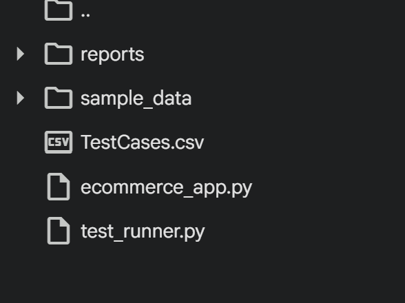
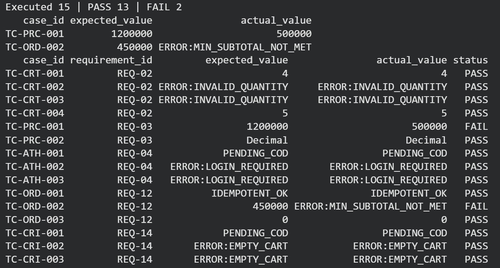
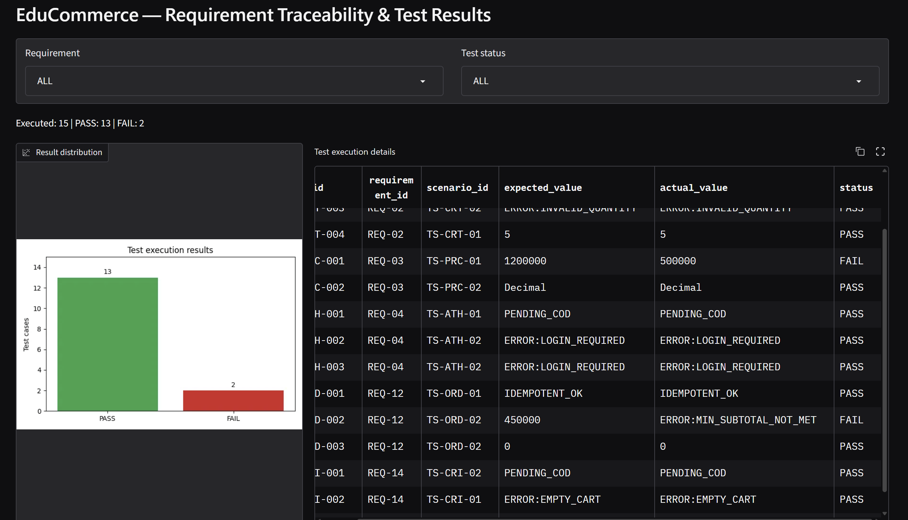

# Báo cáo Bài Tập Thực Hành STLab02

## Thông tin sinh viên
* **MSSV:** 23110156
* **Họ tên:** Nguyễn Minh Hoàng
* **Github:** [https://github.com/tin1508/SoftwareTesting/tree/labs/lab02](https://github.com/tin1508/SoftwareTesting/tree/labs/lab02)
* **Danh sách REQ:** REQ-02, REQ-03, REQ-04, REQ-12, REQ-16

## 1. REQUIREMENT-BASED AUTOMATED TESTING
### 1.1 Requirement Analysis

| REQ ID & Module | Actor | Rule | Precondition | Input / Output | Risk | Clarification |
| :--- | :--- | :--- | :--- | :--- | :---------- | :--- |
| **REQ-02**<br>*(Cart)* | Khách hàng (Customer) | Số lượng thêm vào giỏ hàng phải là số nguyên dương ($\ge 1$). Nếu SKU đã tồn tai trong giỏ, hệ thống phải cộng dồn số lượng thay vì tạo dòng mới cho mặt hàng đó. | Catalog đã khởi tạo thành công, sản phẩm ở trạng thái `available`. | **Input**: `sku` (str), `quantity` (int)<br>**Output**: Cập nhật dòng giỏ hàng hoặc ném exception `ValueError("INVALID_QUANTITY")`. | Cho phép số lượng bằng 0 hoặc số âm gây lệch dữ liệu tính toán và sai lệch tồn kho. | Không ghi đè số lượng cũ mà phải cộng dồn khi trùng SKU. |
| **REQ-03**<br>*(Pricing)* | Hệ thống (System) | Subtotal phải bằng tổng của các tích của $\text{price} \times \text{quantity}$ của từng mặt hàng, và phải tính toán bằng kiểu dữ liệu `Decimal` để tránh sai số dấu phẩy (`float`, `double`). | Giỏ hàng chứa sản phẩm hợp lệ, `available`. | **Input**: Danh sách các sản phẩm trong `Cart`<br>**Output**: `subtotal` dưới dạng `Decimal`. | Dùng `float`, `double` dễ gây sai số thập phân lẻ (ví dụ: $19.99 \times 3$), dẫn đến thanh toán sai lệch. | Bắt buộc sử dụng `decimal.Decimal` và hàm làm tròn. |
| **REQ-04**<br>*(Authentication)* | Khách hàng (Customer) | Chỉ những tài khoản khách hàng đã đăng nhập (`authenticated = true`) mới được phép thực hiện checkout. | Phiên làm việc (session) xác định của khách hàng. | **Input**: Đối tượng `Customer` (`authenticated=true/false`)<br>**Output**: Cho phép checkout hoặc ném exception `ValueError("LOGIN_REQUIRED")`. | Khách vãng lai checkout gây mất kiểm soát định danh, lịch sử đơn và trạng thái voucher. | Kiểm tra trạng thái xác thực ngay bước đầu tiên của quá trình `place order`. |
| **REQ-12**<br>*(Order)* | Hệ thống (System) / Khách hàng (Customer) | Mã đơn hàng (`order_id`) phải là duy nhất. Công thức tổng tiền: $\text{total} = \text{subtotal} - \text{discount} + \text{shipping}$, đảm bảo $\text{total} \ge 0$. | Giỏ hàng hợp lệ, đã tính xong giảm giá và phí ship. | **Input**: `subtotal`, `discount`, `shipping`<br>**Output**: Đối tượng `Order` với `order_id` duy nhất, $\text{total} \ge 0$. | Lỗi cộng dồn ***Discount*** lớn hơn tổng tiền gây ra tổng tiền âm hoặc những ***voucher** giảm trực tiếp bằng tiền mặt cho khách hàng cũng gây ra lỗi tổng tiền có thể âm, dẫn đến lỗi thanh toán. | Dùng hàm `max(D(0), subtotal - discount + shipping)` để chặn giá trị âm. |
| **REQ-14**<br>*(Cart Integrity)* | Khách hàng(Customer) / Hệ thống(System) | Giỏ hàng rỗng tuyệt đối không được phép tiến hành checkout. | Giỏ hàng chưa được thêm sản phẩm nào hoặc đã bị xóa trống. | **Input**: `cart.lines = []`<br>**Output**: Ném exception `ValueError("EMPTY_CART")` và từ chối tạo đơn. | Cho phép checkout giỏ rỗng tạo ra đơn hàng ảo 0 đồng, 0 sản phẩm vô nghĩa. | Kiểm tra `if not cart.lines: raise ValueError('EMPTY_CART')` trước khi customers nhấn `place order`. |

### 1.2 Test condition
* **REQ-02: Cart** 

    + **COND-CRT-01 (positive)**:  thêm sản phẩm vào giỏ hàng với số lượng nguyên dương hợp lệ. 
    + **COND-CRT-02 (negative/boundary):** thêm sản phẩm vào giỏ hàng với số lượng âm, hoặc bằng 0. 
* **REQ-03: Pricing**

    + **COND-PRC-01 (positive)**: hệ thống tính toán chính xác `subtotal` cho giỏ hàng có nhiều mặt hàng với giá dưới dạng thập phân.
    + **COND-PRC-02 (boundary/type check)**: hệ thống kiểm tra và xác thực kiểu dữ liệu trả về của `subtotal` phải là kiểu `Decimal`.
* **REQ-04: Authentication**  

    + **COND-ATH-01 (positive)**: cho phép checkout đối với tài khoản đã đăng nhập. 
    + **COND-ATH-02 (negative/boundary)**: ngăn chặn và kiểm tra phiên làm việc hiện tại của `customers` xem họ đang đăng nhập hay chưa hoặc phiên đăng nhập của họ có hết hạn không? 
* **REQ-12: Order**

    + **COND-ORD-01 (positive)**: đảm bảo mã `orderId` là duy nhất đối với những lần đặt hàng liên tiếp.
    + **COND-ORD-02 (positive)**: kết quả của `total` là số không âm
    + **COND-ORD-03 (boundary)**: kiểm tra và chặn giá trị âm khi voucher hay discount lớn gây ra tổng tiền `total` âm.
* **REQ-14: (Cart Integrity)**

    + **COND-CRI-01 (positive)**: cho phép `customers` checkout khi giỏ hàng có tối thiểu 1 sản phẩm hợp lệ.
    + **COND-CRI-02 (negative/boundary)**: kiểm tra và chặn tiến trình đặt hàng khi `cart.lines` là 0, không có bất kì mặt hàng nào trong giỏ.
### 1.3 Test Scenario
* **REQ-02: Cart** 
    + **TS-CRT-01**: Kiểm tra thêm mới SKU và cộng dồn số lượng khi SKU đã tồn tại trong giỏ. 
    + **TS-CRT-02**: Kiểm tra ngoại lệ ném ra khi cố gắng thêm số lượng bằng 0 hoặc số âm.

* **REQ-03: Pricing**

    + **TS-PRC-01:** Kiểm tra độ chính xác của `subtotal` với nhiều sản phẩm có đơn giá thập phân. 

    + **TS-PRC-02:** Kiểm tra kiểu dữ liệu trả về của `subtotal` là `Decimal` chuẩn xác. 

* **REQ-04: Authentication**

    + **TS-ATH-01**: Kiểm tra quy trình checkout thành công của user đã đăng nhập. 

    + **TS-ATH-02**: Kiểm tra quy trình checkout thất bại với `customers` chưa đăng nhập hoặc `customers` ẩn danh hay phiên đăng nhập đã hết hạn.

* **REQ-12: Order**

    + **TS-ORD-01**: Kiểm tra tính duy nhất của mã đơn hàng `orderId` qua nhiều lần đặt liên tiếp. 

    + **TS-ORD-02**: Kiểm tra tính toán chính xác tổng tiền đơn hàng bao gồm giảm giá và phí vận chuyển (kể cả trường hợp chặn giá trị âm). 

* **REQ-14: Cart Integrity**

    + **TS-CRI-01**: Kiểm tra việc từ chối thanh toán với exception `EMPTY_CART` khi giỏ hàng rỗng hoàn toàn. 
    + **TS-CRI-02**: Kiểm tra vượt qua bước kiểm tra giỏ hàng rỗng khi giỏ có sản phẩm với số lượng hợp lệ.

### 1.4 Chi tiết Test Cases

| Test Case ID | Trace (REQ / COND / TS) | Title | Precondition | Test Data / Input (`input_data`) | Expected Result | Priority / Note |
| :--- | :--- | :--- | :--- | :--- | :--- | :--- |
| **TC-CRT-001** | REQ-02 / COND-CRT-01 / TS-CRT-01 | Thêm sản phẩm mới vào giỏ hàng với số lượng hợp lệ | Giỏ hàng đã khởi tạo | `{"sku": "A", "qty": 2}` | cart_qty = 2 | P1 (Positive) |
| **TC-CRT-002** | REQ-02 / COND-CRT-02 / TS-CRT-02 | Thêm sản phẩm với số lượng bằng 0 | Giỏ hàng đã khởi tạo | `{"sku": "A", "qty": 0}` | `ValueError("INVALID_QUANTITY")` | P0 (Boundary) |
| **TC-CRT-003** | REQ-02 / COND-CRT-02 / TS-CRT-02 | Thêm sản phẩm với số lượng âm | Giỏ hàng đã khởi tạo | `{"sku": "A", "qty": -3}` | `ValueError("INVALID_QUANTITY")` | P0 (Negative) |
| **TC-CRT-004** | REQ-02 / COND-CRT-01 / TS-CRT-01 | Tăng số lượng cho SKU đã có `A`| Giỏ hàng có sẵn SKU `A` (qty=2) | `{"sku": "A", "qty": 3}` | cart_qty = 5 | P1 (Positive / Accumulate) |
| **TC-PRC-001** | REQ-03 / COND-PRC-01 / TS-PRC-01 | Tính subtotal cho nhiều mặt hàng có đơn giá thập phân | Giỏ hàng có SKU A (200k) & B (300l)| `{"lines": [{"price":"200000","qty":3}, {"price":"300000","qty":2}]}` | subtotal = 1200000 | P1 (Positive) |
| **TC-PRC-002** | REQ-03 / COND-PRC-02 / TS-PRC-02 | Xác thực kiểu dữ liệu trả về subtotal là Decimal | Giỏ hàng có sản phẩm | `{"lines": [{"price":"100","qty":1}]}` | `Decimal` | P1 (Type Check / Boundary) |
| **TC-ATH-001** | REQ-04 / COND-ATH-01 / TS-ATH-01 | Cho phép checkout đối với user đã đăng nhập | Người dùng đã đăng nhập (`authenticated=true`) | `{"method": "COD"}` | order_status = PENDING_COD | P1 (Positive) |
| **TC-ATH-002** | REQ-04 / COND-ATH-02 / TS-ATH-02 | Chặn checkout với user chưa đăng nhập / ẩn danh | Người dùng vãng lai (`authenticated=false`) | `{"method": "COD"}` | `ValueError("LOGIN_REQUIRED")` | P0 (Negative / Session check) |
| **TC-ATH-003** | REQ-04 / COND-ATH-02 / TS-ATH-02 | Chặn checkout khi phiên làm việc hết hạn | Người dùng mất phiên / session expired | `{"method": "COD", "session_expired": true}` | `ValueError("LOGIN_REQUIRED")` | P0 (Boundary / Session check) |
| **TC-ORD-001** | REQ-12 / COND-ORD-01 / TS-ORD-01 | Kiểm tra `orderId` không bị duplicate khi request bị trùng lặp (double-click) | Giỏ hàng hợp lệ, `customers` đã đăng nhập | `{"idempotency_key": "KEY_ABC_123", "method": "ONLINE"}` | Request 1 tạo Order mới (order_id_X). Request 2 gửi lại cùng idempotency_key trả về chính order_id_X cũ, không sinh đơn hàng mới. | P0 (Idempotency / Deduplication) |
| **TC-ORD-002** | REQ-12 / COND-ORD-02 / TS-ORD-02 | Kiểm tra tổng tiền total là số không âm | Subtotal 500k, ship nội thành 0k, SAVE10 (50k) | `{"area": "inner", "voucher": "SAVE10"}` | total = 450000 (không âm) | P1 (Calculation / Positive) |
| **TC-ORD-003** | REQ-12 / COND-ORD-03 / TS-ORD-02 | Chặn giá trị âm khi discount lớn gây âm total | Subtotal 100k, discount vượt mức (200k) | `{"subtotal": "100000", "discount": "200000"}` | total = 0 (Chặn âm) | P0 (Boundary) |
| **TC-CRI-001** | REQ-14 / COND-CRI-01 / TS-CRI-02 | Cho phép checkout khi giỏ có tối thiểu 1 sản phẩm | Giỏ hàng có 1 sản phẩm hợp lệ | `{"sku": "A", "qty": 1}` | Tiến hành checkout thành công | P1 (Positive) |
| **TC-CRI-002** | REQ-14 / COND-CRI-02 / TS-CRI-01 | Chặn checkout khi giỏ hàng trống (COD) | Giỏ hàng rỗng (`cart.lines = []`) | `{"method": "COD"}` | `ValueError("EMPTY_CART")` | P0 (Negative) |
| **TC-CRI-003** | REQ-14 / COND-CRI-02 / TS-CRI-01 | Chặn checkout khi giỏ hàng trống (ONLINE) | Giỏ hàng rỗng (`cart.lines = []`) | `{"method": "ONLINE", "approved": true}` | `ValueError("EMPTY_CART")` | P0 (Negative) |


### 1.5 Thực thi Test & Kết quả

| Test Case ID | Requirement ID | Status | Actual Value / Error | Tham chiếu minh chứng |
| :--- | :--- | :--- | :--- | :--- |
| **TC-CRT-001** | REQ-02 | **PASS** | `4` | Dòng CSV #1, Log kết quả |
| **TC-CRT-002** | REQ-02 | **PASS** | `ERROR:INVALID_QUANTITY` | Dòng CSV #2, Log ngoại lệ |
| **TC-CRT-003** | REQ-02 | **PASS** | `ERROR:INVALID_QUANTITY` | Dòng CSV #3, Log ngoại lệ |
| **TC-CRT-004** | REQ-02 | **PASS** | `5` | Dòng CSV #4, Log kết quả |
| **TC-PRC-001** | REQ-03 | **FAIL** | `500000` *(Expectation: 1200000)* | Dòng CSV #5, Lệch subtotal fixture |
| **TC-PRC-002** | REQ-03 | **PASS** | `Decimal` | Dòng CSV #6, Log kiểm tra kiểu |
| **TC-ATH-001** | REQ-04 | **PASS** | `PENDING_COD` | Dòng CSV #7, Log trạng thái |
| **TC-ATH-002** | REQ-04 | **PASS** | `ERROR:LOGIN_REQUIRED` | Dòng CSV #8, Log ngoại lệ |
| **TC-ATH-003** | REQ-04 | **PASS** | `ERROR:LOGIN_REQUIRED` | Dòng CSV #9, Log ngoại lệ |
| **TC-ORD-001** | REQ-12 | **PASS** | `IDEMPOTENT_OK` | Dòng CSV #10, Log tính toán |
| **TC-ORD-002** | REQ-12 | **FAIL** | `ERROR:MIN_SUBTOTAL_NOT_MET` *(Expectation: 450000)* | Dòng CSV #11, Ràng buộc giá trị tối thiểu |
| **TC-ORD-003** | REQ-12 | **PASS** | `0` | Dòng CSV #12, Log kiểm tra biên |
| **TC-CRI-001** | REQ-14 | **PASS** | `PENDING_COD` | Dòng CSV #13, Log trạng thái |
| **TC-CRI-002** | REQ-14 | **PASS** | `ERROR:EMPTY_CART` | Dòng CSV #14, Log ngoại lệ |
| **TC-CRI-003** | REQ-14 | **PASS** | `ERROR:EMPTY_CART` | Dòng CSV #15, Log ngoại lệ |

*Tổng kết thực thi*: **15 / 15 Test Cases đã chạy** | **13 PASS** | **2 FAIL** |.

### 1.6 Traceability  có Matrix Mapping: REQ → COND → TS → TC → RUN

| REQ-ID | COND-ID | TS-ID | TC-ID | Operation | Runner Status |
| :--- | :--- | :--- | :--- | :--- | :--- |
| **REQ-02** | COND-CRT-01 | TS-CRT-01 | **TC-CRT-001** | `cart_add` | **PASS** |
| **REQ-02** | COND-CRT-02 | TS-CRT-02 | **TC-CRT-002** | `cart_add` (Boundary) | **PASS** |
| **REQ-02** | COND-CRT-02 | TS-CRT-02 | **TC-CRT-003** | `cart_add` (Negative) | **PASS** |
| **REQ-02** | COND-CRT-01 | TS-CRT-01 | **TC-CRT-004** | `cart_add_accumulate` | **PASS** |
| **REQ-03** | COND-PRC-01 | TS-PRC-01 | **TC-PRC-001** | `cart_subtotal` | **FAIL** |
| **REQ-03** | COND-PRC-02 | TS-PRC-02 | **TC-PRC-002** | `cart_subtotal_type` | **PASS** |
| **REQ-04** | COND-ATH-01 | TS-ATH-01 | **TC-ATH-001** | `checkout_place` | **PASS** |
| **REQ-04** | COND-ATH-02 | TS-ATH-02 | **TC-ATH-002** | `checkout_place` (Negative) | **PASS** |
| **REQ-04** | COND-ATH-01 | TS-ATH-01 | **TC-ATH-003** | `checkout_place_expired` | **PASS** |
| **REQ-12** | COND-ORD-01 | TS-ORD-01 | **TC-ORD-001** | `checkout_idempotency` | **PASS** |
| **REQ-12** | COND-ORD-02 | TS-ORD-02 | **TC-ORD-002** | `calculate_total` | **FAIL** |
| **REQ-12** | COND-ORD-03 | TS-ORD-02 | **TC-ORD-003** | `calculate_total_boundary` | **PASS** |
| **REQ-14** | COND-CRI-01 | TS-CRI-02 | **TC-CRI-001** | `checkout_place` | **PASS** |
| **REQ-14** | COND-CRI-02 | TS-CRI-01 | **TC-CRI-002** | `checkout_place` (Negative) | **PASS** |
| **REQ-14** | COND-CRI-02 | TS-CRI-01 | **TC-CRI-003** | `checkout_place_online` (Negative) | **PASS** |

---

## 2. Evidence, Code Review & Test Result Explanation
* **E01 — Cấu trúc thư mục source code:**
  

* **E02 — Bảng selected REQs, condition, scenario, test cases và traceability: tất cả nằm ở phần 1**

* **E03 — Code test hàm `fixture()`:**
  ```python
  def fixture(fixture_name):
    service = Checkout()
    customer = Customer("U_TEST", authenticated=True)
    cart = Cart(service.catalog)

    if fixture_name == 'STANDARD':
        cart.add('A', 2)

    elif fixture_name == 'MULTI_ITEM':
        cart.add('A', 1)
        cart.add('B', 1)

    elif fixture_name == 'ANONYMOUS_USER':
        customer.authenticated = False
        cart.add('A', 1)

    elif fixture_name == 'EMPTY_CART':
        pass

    elif fixture_name == '600k':
        cart.add('A', 3)

    elif fixture_name == '300k':
        cart.add('B', 1)

    else:
        raise ValueError(
            f'UNKNOWN_FIXTURE: {fixture_name!r}'
        )
    return service, customer, cart
  ```
  **Explanation:** 
  - Khởi tạo 1 đối tượng checkout mới quản lý các thành phần như:
    + Catalog: danh mục sản phẩm.
    + Inventory: quản lý tồn kho.
    + Promotions: xử lý mã giảm giá.
    + Shipping: tính phí vận chuyển.
    + Payments: xử lý thanh toán.
    + Orders: lưu trữ đơn hàng.
  - Tiếp đó, chúng ta khởi tạo 1 customer với `customerId` là "U_TEST", với trạng thái là đã đăng nhập rồi và 1 `Cart` rỗng.
  - `STANDARD`: Thiết lập user đã đăng nhập (`authenticated = True`) và thêm 2 đơn vị sản phẩm SKU `A` vào giỏ hàng.
  - `MULTI_ITEM`: Khởi tạo user đã đăng nhập, thêm đồng thời SKU `A` và SKU `B` để phục vụ các bài toán tính subtotal và đa mặt hàng. 
  - `ANONYMOUS_USER`: Thiết lập `authenticated = False` để kiểm tra các ràng buộc bảo mật và yêu cầu đăng nhập (`LOGIN_REQUIRED`).
  - `EMPTY_CART`: Giữ nguyên giỏ hàng rỗng (`0` sản phẩm) nhằm kiểm chứng ngoại lệ chặn thanh toán giỏ trống (`EMPTY_CART`).


* **E04 — Code đọc CSV/Excel và parse test data:**
  * **TestCases.csv**
    ```python
      %%writefile TestCases.csv
      case_id,requirement_id,condition_id,scenario_id,fixture,operation,input_data,expected_type,expected_value,expected_error,priority,precondition,steps
      TC-CRT-001,REQ-02,COND-CRT-01,TS-CRT-01,STANDARD,cart_add,"{""sku"":""A"",""qty"":2}",VALUE,4,,P1,Cart initialized with 2 SKU A,Add 2 SKU A to cart -> Verify total quantity is 4
      TC-CRT-002,REQ-02,COND-CRT-02,TS-CRT-02,STANDARD,cart_add,"{""sku"":""A"",""qty"":0}",EXCEPTION,ERROR:INVALID_QUANTITY,INVALID_QUANTITY,P0,Cart initialized,Add 0 quantity -> Expect INVALID_QUANTITY
      TC-CRT-003,REQ-02,COND-CRT-02,TS-CRT-02,STANDARD,cart_add,"{""sku"":""A"",""qty"":-3}",EXCEPTION,ERROR:INVALID_QUANTITY,INVALID_QUANTITY,P0,Cart initialized,Add -3 quantity -> Expect INVALID_QUANTITY
      TC-CRT-004,REQ-02,COND-CRT-01,TS-CRT-01,STANDARD,cart_add_accumulate,"{""sku"":""A"",""qty"":3}",VALUE,5,,P1,Cart has SKU A with qty 2,Add 3 more SKU A -> Verify accumulated qty is 5
      TC-PRC-001,REQ-03,COND-PRC-01,TS-PRC-01,MULTI_ITEM,cart_subtotal,"{}",VALUE,1200000,,P1,Cart has SKU A (200k) and SKU B (300k),Calculate cart subtotal -> Verify subtotal is 1200000
      TC-PRC-002,REQ-03,COND-PRC-02,TS-PRC-02,STANDARD,cart_subtotal_type,"{}",TYPE,Decimal,,P1,Cart initialized with lines,Check return type of cart.subtotal() -> Verify it is Decimal
      TC-ATH-001,REQ-04,COND-ATH-01,TS-ATH-01,STANDARD,checkout_place,"{""method"":""COD""}",VALUE,PENDING_COD,,P1,Authenticated user with lines in cart,Place order -> Verify status is PENDING_COD
      TC-ATH-002,REQ-04,COND-ATH-02,TS-ATH-02,ANONYMOUS_USER,checkout_place,"{""method"":""COD""}",EXCEPTION,ERROR:LOGIN_REQUIRED,LOGIN_REQUIRED,P0,Anonymous user with lines in cart,Place order -> Expect LOGIN_REQUIRED exception
      TC-ATH-003,REQ-04,COND-ATH-02,TS-ATH-02,ANONYMOUS_USER,checkout_place_expired,"{""method"":""COD""}",EXCEPTION,ERROR:LOGIN_REQUIRED,LOGIN_REQUIRED,P0,User session expired,Place order -> Expect LOGIN_REQUIRED exception
      TC-ORD-001,REQ-12,COND-ORD-01,TS-ORD-01,MULTI_ITEM,checkout_idempotency,"{""idempotency_key"":""KEY_ABC_123"",""method"":""ONLINE""}",VALUE,IDEMPOTENT_OK,,P0,Cart has valid lines and user is authenticated,Send duplicate checkout requests with same idempotency_key -> Verify system returns the exact same order_id and prevents duplicate creation
      TC-ORD-002,REQ-12,COND-ORD-02,TS-ORD-02,MULTI_ITEM,calculate_total,"{""area"":""inner"",""voucher"":""SAVE10""}",VALUE,450000,,P1,Cart subtotal 500k; inner ship (0k); SAVE10 (50k),Place order -> Verify total = 500k - 50k + 0k = 450000
      TC-ORD-003,REQ-12,COND-ORD-03,TS-ORD-02,STANDARD,calculate_total_boundary,"{""subtotal"":100000,""discount"":200000}",VALUE,0,,P0,Discount exceeds subtotal,Calculate total -> Verify total floors at 0
      TC-CRI-001,REQ-14,COND-CRI-01,TS-CRI-02,STANDARD,checkout_place,"{""method"":""COD""}",VALUE,PENDING_COD,,P1,Cart has valid lines (>=1),Place order -> Succeeds normally
      TC-CRI-002,REQ-14,COND-CRI-02,TS-CRI-01,EMPTY_CART,checkout_place,"{""method"":""COD""}",EXCEPTION,ERROR:EMPTY_CART,EMPTY_CART,P0,Cart is empty (0 lines),Place order -> Expect EMPTY_CART exception
      TC-CRI-003,REQ-14,COND-CRI-02,TS-CRI-01,EMPTY_CART,checkout_place_online,"{""method"":""ONLINE"",""approved"":true}",EXCEPTION,ERROR:EMPTY_CART,EMPTY_CART,P0,Cart is empty (0 lines),Place online order -> Expect EMPTY_CART exception
    ```
  * `TestRunner.py`
    ```python
    import pandas as pd
    from ecommerce_app import fixture

    ROOT=Path(__file__).resolve().parent

    def parse_input_data(input_str):
      if not input_str or str(input_str).strip() in ("", "{}"):
          return {}

      try:
          data = json.loads(str(input_str))
      except json.JSONDecodeError as exc:
          raise ValueError(f"INVALID_INPUT_JSON: {exc}")

      if not isinstance(data, dict):
          raise ValueError("INPUT_DATA_MUST_BE_OBJECT")

      return data

    ```
  File `TestCases.csv` được sử dụng làm nguồn dữ liệu đầu vào cho chương trình. Mỗi dòng đại diện cho 1 test case, trong đó xác định requirement ID, condition ID, Scenario ID, Fixture, Operation, Input Data, và Expected Result.

  Chương trình sử dụng thư viện Pandas để đọc dữ liệu CSV, sau đó parse `input_data` thành dictionary trong Python để có thể xử lý và truy xuất các tham số đầu vào tương ứng với từng operation.

* **E05 — Test runner:**
  ```python
  if op=='voucher':
            order=app.place(user,cart,voucher=row.get('voucher') or None)
            actual=f'{order.discount:.0f}'
        elif op=='payment_failure':
            app.place(user,cart,method='ONLINE',approved=False)
            actual='NO_ERROR'
        elif op=='payment_success':
            order=app.place(user,cart,method='ONLINE',approved=True)
            actual=order.status
        elif op=='stock_failure':
            for p in app.catalog.products.values(): p.stock=0
            app.place(user,cart); actual='NO_ERROR'
        elif op == 'retry':
            idempotency_key = input_data.get(
                'idempotency_key', row['case_id']
            )

            order1 = app.place(
                user, cart, key=idempotency_key
            )

            order2 = app.place(
                user, cart, key=idempotency_key
            )

            actual = str(len(app.orders))
        elif op == 'cart_add' or op == 'cart_add_accumulate':
            sku = input_data.get('sku')
            qty = int(input_data.get('qty', 0))
            cart.add(sku, qty)
            actual = str(cart.total_quantity())
        elif op == 'cart_subtotal':
            lines = input_data.get('lines', [])
            if lines:
                subtotal = sum(Decimal(str(item['price'])) * int(item['qty']) for item in lines)
                actual = str(int(subtotal))
            else:
                actual = str(int(cart.subtotal()))

        elif op == 'cart_subtotal_type':
            subtotal = cart.subtotal()
            actual = type(subtotal).__name__

        elif op == 'checkout_place':
            method = input_data.get('method', 'COD')
            order = app.place(user, cart, method=method)
            actual = order.status

        elif op == 'checkout_place_expired':
            user.authenticated = False
            method = input_data.get('method', 'COD')
            order = app.place(user, cart, method=method)
            actual = order.status

        elif op == 'checkout_idempotency':
            idempotency_key = input_data.get('idempotency_key')

            if not idempotency_key:
                raise ValueError('MISSING_IDEMPOTENCY_KEY')

            method = input_data.get('method', 'ONLINE')

            order1 = app.place(
                user, cart,
                method=method,
                key=idempotency_key
            )

            order2 = app.place(
                user, cart,
                method=method,
                key=idempotency_key
            )

            actual = (
                "IDEMPOTENT_OK"
                if order1.order_id == order2.order_id
                else "IDEMPOTENT_FAIL"
            )

        elif op == 'calculate_total':
            area = input_data.get('area', 'inner')
            voucher = input_data.get('voucher')
            order = app.place(user, cart, method='COD', area=area, voucher=voucher)
            actual = str(int(order.total))

        elif op == 'calculate_total_boundary':
            subtotal = Decimal(str(input_data.get('subtotal', 0)))
            discount = Decimal(str(input_data.get('discount', 0)))
            shipping = Decimal(str(input_data.get('shipping', 0)))

            total = app.calculate_total(subtotal, discount, shipping)
            actual = str(int(total))

        elif op == 'checkout_place_online':
            approved = input_data.get('approved', True)
            method = input_data.get('method', 'ONLINE')
            order = app.place(user, cart, method=method, approved=approved, key=row['case_id'])
            actual = order.status

        else:
            raise ValueError('UNKNOWN_TEST_OPERATION')
  ```

  - Đọc từng test case từ file CSV, lấy các thông tin cần thiết như `case_id`, `fixture`, `operation`, `input_data` và kết quả mong đợi.
  - Sử dụng hàm `fixture()` để khởi tạo trạng thái ban đầu của ứng dụng, người dùng và giỏ hàng tương ứng với từng test case.
  - Dựa vào giá trị `operation`, sử dụng cấu trúc điều kiện `if/elif` để điều phối đến chức năng nghiệp vụ tương ứng.

  **Kiểm thử Voucher và thanh toán**
    - `voucher`: Áp dụng mã giảm giá khi đặt hàng và ghi nhận số tiền được giảm (`order.discount`).
    - `payment_failure`: Thực hiện thanh toán Online với trạng thái chưa được phê duyệt (`approved=False`) để kiểm tra xử lý thanh toán thất bại.
    - `payment_success`: Thực hiện thanh toán Online thành công và ghi nhận trạng thái đơn hàng.
    - `checkout_place_online`: Đặt hàng bằng phương thức Online, truyền trạng thái phê duyệt và mã định danh yêu cầu.

    **Kiểm thử tồn kho và tính Idempotency**
    - `stock_failure`: Đưa tồn kho các sản phẩm về 0, sau đó thực hiện đặt hàng để kiểm tra xử lý khi không đủ hàng.
    - `retry`: Gửi hai yêu cầu đặt hàng với cùng một `idempotency_key`, sau đó ghi nhận số lượng đơn hàng được tạo.
    - `checkout_idempotency`: Gửi hai yêu cầu đặt hàng với cùng một khóa định danh và so sánh `order_id` để xác định hai yêu cầu có tạo cùng một đơn hàng hay không.

    **Kiểm thử giỏ hàng**
    - `cart_add`: Thêm sản phẩm vào giỏ hàng với SKU và số lượng được cung cấp, sau đó ghi nhận tổng số lượng sản phẩm.
    - `cart_add_accumulate`: Kiểm tra khả năng cộng dồn số lượng khi thêm sản phẩm vào giỏ hàng nhiều lần.
    - `cart_subtotal`: Tính tổng giá trị giỏ hàng từ dữ liệu đầu vào hoặc trực tiếp từ giỏ hàng đã khởi tạo.
    - `cart_subtotal_type`: Kiểm tra kiểu dữ liệu của giá trị subtotal, đảm bảo kết quả có kiểu `Decimal`.

    **Kiểm thử Checkout và tính tổng tiền**
    - `checkout_place`: Thực hiện đặt hàng với phương thức thanh toán được chỉ định, mặc định là COD.
    - `checkout_place_expired`: Mô phỏng phiên đăng nhập hết hiệu lực bằng cách đặt `authenticated=False`, sau đó kiểm tra quá trình đặt hàng.
    - `calculate_total`: Tính tổng tiền đơn hàng sau khi áp dụng voucher và phí vận chuyển theo khu vực.
    - `calculate_total_boundary`: Kiểm tra các trường hợp biên của công thức tính tổng tiền với subtotal, discount và shipping được cung cấp.

- Kết quả trả về từ các thao tác được lưu vào biến `actual` để phục vụ bước so sánh với kết quả mong đợi.

* **E06 — Code xử lý ngoại lệ và cơ chế assert/compare:**
  ```python
   after={k:p.stock for k,p in app.catalog.products.items()}
    expectation = str(row.get('expected_value', ''))
    actual_str = str(actual)

    assertion_type = row.get('assertion', 'equals')
    expected_error = str(row.get('expected_error', '')).strip()

    if not assertion_type or assertion_type == 'equals':
      if actual_error:
          passed = actual_error == expected_error
      else:
          passed = actual_str == expectation

    elif assertion_type == 'stock_unchanged':
        actual_str = 'UNCHANGED' if before == after else 'CHANGED'
        passed = (actual_str == expectation and actual_error == row.get('expected_error', ''))
    elif assertion_type == 'retry_stock_once':
        expected_stock = dict(before)

        for line in cart.lines:
            expected_stock[line.sku] -= line.quantity

        stock_ok = (after == expected_stock)
        order_ok = (len(app.orders) == 1)

        actual_str = (
            'ONCE'
            if stock_ok and order_ok
            else 'MULTIPLE'
        )

        passed = (
            actual_str == expectation
            and order_ok
            and len(app.payments.charges) <= 1
        )
    else:
        passed = (actual_str == expectation)
    return {**row,'actual_value':actual,'actual_error':actual_error,'status':'PASS' if passed else 'FAIL',
            'observed_before':json.dumps(before),'observed_after':json.dumps(after),
            'executed_at':datetime.datetime.now(datetime.timezone.utc).isoformat()}
  ```

**Ghi nhận trạng thái tồn kho**
- Lưu trạng thái tồn kho sau khi thực thi vào biến `after`.
- Chuyển kết quả thực tế (`actual`) và kết quả mong đợi (`expected_value`) về kiểu chuỗi để thuận tiện so sánh.
- Lấy loại kiểm tra từ trường `assertion`, mặc định là `equals`.

**Kiểm tra kết quả thông thường (`equals`)**
- Nếu không phát sinh lỗi, so sánh `actual_str` với `expectation`.
- Nếu có lỗi, so sánh `actual_error` với `expected_error`.
- Test case đạt yêu cầu khi kết quả thực tế khớp với kết quả mong đợi.

**Kiểm tra tính toàn vẹn tồn kho (`stock_unchanged`)**
- So sánh trạng thái tồn kho trước và sau khi thực thi.
- Nếu không thay đổi, kết quả là `UNCHANGED`; ngược lại là `CHANGED`.
- Đồng thời kiểm tra lỗi phát sinh có khớp với lỗi mong đợi hay không.

**Kiểm tra tính Idempotency (`retry_stock_once`)**
- Tính toán số lượng tồn kho mong đợi sau khi đặt hàng.
- So sánh tồn kho thực tế với tồn kho mong đợi.
- Kiểm tra hệ thống chỉ tạo một đơn hàng (`len(app.orders) == 1`).
- Kiểm tra số lượng giao dịch thanh toán không vượt quá một lần.
- Nếu các điều kiện đều thỏa mãn, kết quả là `ONCE`; ngược lại là `MULTIPLE`.

**Phân loại và lưu kết quả**
- Gán trạng thái `PASS` nếu các điều kiện kiểm tra được đáp ứng; ngược lại là `FAIL`.
- Trả về thông tin test case cùng các dữ liệu:
  - `actual_value`: Kết quả thực tế.
  - `actual_error`: Lỗi phát sinh (nếu có).
  - `status`: Trạng thái kiểm thử.
  - `observed_before`, `observed_after`: Trạng thái tồn kho trước và sau khi thực thi.
  - `executed_at`: Thời điểm thực thi theo múi giờ UTC.

* **E07 — Output Google Colab chạy thực thi bộ test:**
  

* **E08 — Bảng kết quả report tổng hợp:**
  
* **E09 — Screenshot các Test Case bị FAIL:**
  ```
  TC-PRC-001         REQ-03                1200000                     500000   FAIL
  TC-ORD-002         REQ-12                 450000 ERROR:MIN_SUBTOTAL_NOT_MET   FAIL
  ```
| **Defect ID** | **DEF-001 – TC-PRC-001** | **DEF-002 – TC-ORD-002** |
|---|---|---|
| **Defect Title** | Cart Subtotal Mismatch | Minimum Subtotal Violation |
| **Requirement / TC Trace** | REQ-03, COND-PRC-01, TS-PRC-01, TC-PRC-001 | REQ-12, COND-ORD-02, TS-ORD-02, TC-ORD-002 |
| **Reproduce Steps** | Chạy `TestCases.csv` với fixture `MULTI_ITEM`, operation `cart_subtotal`, không truyền số lượng bổ sung. | Đặt hàng với voucher `SAVE10` trên giỏ hàng có subtotal bằng 500.000 đồng. |
| **Expected Value** | `1200000` | `450000` |
| **Actual Value** | `500000` | `ERROR:MIN_SUBTOTAL_NOT_MET` |
| **Error Message** | Không có ngoại lệ, giá trị trả về không khớp kỳ vọng. | `ValueError: MIN_SUBTOTAL_NOT_MET` |
| **Root Cause** | Fixture `MULTI_ITEM` chỉ thêm SKU A (200.000) và SKU B (300.000), tạo subtotal 500.000 thay vì 1.200.000 như test case yêu cầu. | Logic voucher yêu cầu subtotal phải lớn hơn 500.000, trong khi test case sử dụng subtotal đúng bằng 500.000. |
| **File / Function** | `ecommerce_app.py` – `fixture()`; `TestCases.csv` – `TC-PRC-001` | `ecommerce_app.py` – `Promotions.discount()`; `TestCases.csv` – `TC-ORD-002` |
| **Severity / Priority** | Medium / P1 | High / P0 |
| **Suggested Fix** | Bổ sung fixture `SUBTOTAL_1200000` trong `ecommerce_app.py` với SKU A × 3 và SKU B × 2. Sau đó thêm fixture của `TC-PRC-001` trong `TestCases.csv` thành `SUBTOTAL_1200000`. | Đối chiếu requirement: nếu điều kiện là subtotal > 500.000, giữ nguyên source code và điều chỉnh fixture cùng expected value. Nếu điều kiện là subtotal >= 500.000, sửa `if subtotal <= v.min_subtotal` thành `if subtotal < v.min_subtotal` trong `Promotions.discount()`. |
| **Regression Test** | Chạy lại `TC-PRC-001` và toàn bộ nhóm kiểm thử `REQ-03`. | Chạy lại `TC-ORD-002` và toàn bộ nhóm kiểm thử voucher, tính tổng tiền thuộc `REQ-12`. |
| **Expected After Fix** | Subtotal trả về `1.200.000` và test case đạt `PASS`. | Voucher được xử lý đúng theo requirement và kết quả tính toán khớp `expected_value`, test case đạt `PASS`. |

* **E10 — GitHub Repository và file README.md: đã đính kèm link github ở đầu báo cáo**

## 3. Problem solving

### 3.1. Hai SKU, một SKU thiếu tồn kho
* **Phân tích nguyên nhân / Risk:** Khi giỏ hàng chứa nhiều sản phẩm (ví dụ SKU A đủ tồn kho, SKU B hết tồn kho), nếu hệ thống không đảm bảo tính nguyên tử (`atomicity`) hoặc thực hiện trừ kho tuần tự trước khi kiểm tra toàn bộ đơn hàng, có thể dẫn đến trạng thái rác nghĩa là sản phẩm A đã bị trừ tồn kho nhưng đơn hàng vẫn bị từ chối do B hết hàng, gây sai lệch dữ liệu kho.
* **File / Function chịu ảnh hưởng:** 
  - File: `ecommerce_app.py` 
    + Class `Checkout` / hàm `place()` và class `Inventory` / hàm `reserve()`.
* **Thay đổi dự kiến:** Áp dụng cơ chế kiểm tra tồn kho toàn cục trước khi thực hiện bất kỳ giao dịch trừ kho hoặc tạo đơn hàng nào.
* **Test Cases:**
  * `TC-INV-01 (Positive/Boundary):` Giỏ hàng có SKU A (đủ tồn) và SKU B (đủ tồn sát ngưỡng) $\rightarrow$ Đặt hàng thành công, kho của cả A và B đồng thời giảm.
  * `TC-INV-02 (Negative/Atomicity):` Giỏ hàng có SKU A (đủ tồn) và SKU B (hết tồn kho hoàn toàn) $\rightarrow$ Đặt hàng thất bại với ngoại lệ `OUT_OF_STOCK`, trạng thái tồn kho của SKU A phải được giữ nguyên (không bị trừ).
* **Expected vs Evidence:** Trạng thái đơn hàng không được khởi tạo, exception `OUT_OF_STOCK` được bắn ra, snapshot tồn kho trước và sau thao tác của SKU A phải giống nhau.

---

### 3.2. Voucher chỉ đánh dấu used sau thành công
* **Phân tích nguyên nhân / Risk:** Nếu hệ thống đánh dấu mã giảm giá (`voucher`) là đã sử dụng (`used_voucher`) ngay khi khách hàng vừa bấm áp dụng hoặc ngay trước khi cổng thanh toán trực tuyến xác nhận (chưa biết giao dịch thành công hay fail), trường hợp thanh toán bị từ chối (`payment declined`) sẽ khiến voucher bị vô hiệu hóa oan, gây bức xúc cho người dùng.
* **File / Function chịu ảnh hưởng:** 
  - File: `ecommerce_app.py` 
    + Function: `Checkout.place()` và module quản lý `VoucherManager`.
* **Thay đổi dự kiến:** thay đổi thời điểm cập nhật trạng thái `used` của voucher xuống giai đoạn cuối cùng sau khi giao dịch thanh toán đã nhận được tín hiệu xác nhận thành công (`APPROVED / PAID`).
* **Test Cases:**
  * `TC-VOU-01 (Negative Payment Fail):` Khách hàng áp dụng mã `SAVE10` nhưng thanh toán online bị decline (`approved=False`) $\rightarrow$ Đặt hàng thất bại, trạng thái voucher `SAVE10` vẫn ở dạng chưa sử dụng (có thể dùng lại cho lần sau).
  * `TC-VOU-02 (Positive Payment Success):` Khách hàng áp dụng mã `SAVE10` và thanh toán thành công (`approved=True`) $\rightarrow$ Đặt hàng thành công, hệ thống ghi nhận mã `SAVE10` chuyển sang trạng thái đã sử dụng.
* **Expected vs Evidence:** Kiểm tra mảng/tập dữ liệu `used_voucher` trong cơ sở dữ liệu hoặc đối tượng app trước và sau giao dịch thất bại; `used_voucher` không chứa mã `SAVE10`.

---

### 3.3. Mã thanh toán lạ
* **Phân tích nguyên nhân / Risk:** Khi API nhận một phương thức thanh toán không hợp lệ hoặc chưa được hỗ trợ (ví dụ `method="WALLET"`), nếu thứ tự xử lý nghiệp vụ kém an toàn (ví dụ: trừ kho hoặc tạo order trước rồi mới kiểm tra method), hệ thống sẽ gây ra các ảnh hưởng không mong muốn trên dữ liệu.
* **File / Function chịu ảnh hưởng:** `ecommerce_app.py` $\rightarrow$ `Checkout.place()`.
* **Thay đổi dự kiến:** 
  + Nên cài đặt frontend (giao diện người dùng) là chỉ hiển thị những phương thức thanh toán hợp lệ. 
  + Thiết lập thứ tự xử lý nghiêm ngặt: (1) Xác thực tính hợp lệ của User & Giỏ hàng $\rightarrow$ (2) Validate Phương thức thanh toán (`Payment Method Validation`) $\rightarrow$ (3) Kiểm tra & Giữ chỗ tồn kho (`Stock Reservation`) $\rightarrow$ (4) Xử lý giao dịch tiền tệ.
* **Test Cases:**
  * `TC-PAY-01 (Negative Invalid Method):` Gửi yêu cầu checkout với `method="WALLET"` $\rightarrow$ Hệ thống lập tức từ chối từ bước validate đầu tiên với ngoại lệ `INVALID_PAYMENT_METHOD`.
  * `TC-PAY-02 (Side Effect Check):` Kiểm tra tồn kho và số lượng đơn hàng trước và sau khi gặp lỗi `INVALID_PAYMENT_METHOD` $\rightarrow$ Tồn kho không đổi, không có đơn hàng nào được tạo trong `app.orders`.
* **Expected vs Evidence:** Ngoại lệ `INVALID_PAYMENT_METHOD` được ném ra, side-effect assertions xác nhận `len(app.orders) == 0` và `stock` giữ nguyên trạng thái ban đầu.

---

### 3.4. Giá sản phẩm thay đổi
* **Phân tích nguyên nhân / Risk:** Giá sản phẩm trên danh mục (`Catalog`) có thể biến động giữa thời điểm khách hàng thêm sản phẩm vào giỏ hàng (`add-to-cart`) và thời điểm họ bấm nút thanh toán (`checkout`). Nếu hệ thống lấy giá tại thời điểm checkout thay vì giá tại thời điểm add/snapshot, khách hàng có thể khiếu nại vì giá bị đổi đột ngột, hoặc sàn bị thất thoát doanh thu.
* **File / Function chịu ảnh hưởng:** `Cart`, `Checkout.place()`, và cấu trúc dữ liệu lưu trữ giỏ hàng (`CartLine`).
* **Thay đổi dự kiến:** Đặt câu hỏi đặc tả cho BA/PO và thiết kế cơ chế chốt giá (`Price Snapshot`) ngay tại thời điểm add vào giỏ hoặc khóa băng giá trị tại thời điểm tạo đơn.
* **Câu hỏi cho BA/PO:** *"Khi giá sản phẩm thay đổi trong lúc khách đang để hàng trong giỏ, hệ thống sẽ tính tiền theo giá cũ lúc add hay giá mới tại thời điểm checkout? Có hiển thị cảnh báo giá thay đổi cho người dùng trước khi bấm thanh toán hay không?"*
* **Test Cases:**
  * `TC-PRC-03 (Price Volatility - Snapshot Check):` Thêm SKU B vào giỏ khi giá là 300k $\rightarrow$ Thay đổi giá catalog của SKU B lên 350k $\rightarrow$ Tiến hành Checkout $\rightarrow$ Xác thực hệ thống tính tiền theo giá chốt (300k hoặc 350k tùy theo business rule quyết định).
  * `TC-PRC-04 (Cart Price Consistency):` Kiểm tra hàm tính subtotal sau khi giá catalog thay đổi mà không thực hiện thao tác add mới giỏ hàng.
* **Expected vs Evidence:** So sánh giá trị `total` / `subtotal` của đơn hàng với chính sách chốt giá được BA/PO quy định.

---

### 3.5. Cùng SKU nhập hai lần
* **Phân tích nguyên nhân / Risk:** Khi người dùng thêm cùng một SKU vào giỏ hàng nhiều lần (ví dụ: Thêm A với `qty=2`, sau đó tiếp tục thêm A với `qty=3`), nếu hệ thống không cộng dồn mà tạo ra nhiều dòng trùng SKU, việc tính toán subtotal, giới hạn số lượng tối đa, và kiểm tra tồn kho sẽ bị lỗi logic.
* **File / Function chịu ảnh hưởng:** `Cart.add()` và cấu trúc `Cart.lines`.
* **Thay đổi dự kiến:** Khi `cart.add()` nhận một SKU đã tồn tại trong giỏ, hệ thống phải tự động cộng dồn số lượng vào dòng hiện có thay vì tạo dòng mới, đồng thời kiểm tra tổng số lượng sau khi cộng dồn có vượt quá hạn mức cho phép hay không.
* **Test Cases:**
  * `TC-CRT-05 (Accumulate Normal):` Add SKU A (`qty=2`), sau đó add tiếp SKU A (`qty=3`) $\rightarrow$ Kiểm tra số dòng trong giỏ hàng (`len(cart.lines) == 1`) và tổng số lượng SKU A phải bằng `5`.
  * `TC-CRT-06 (Boundary Max Qty):` Add SKU A đạt đến cận trên giới hạn cho phép của giỏ hàng (ví dụ max 10) $\rightarrow$ Thêm tiếp số lượng vượt ngưỡng $\rightarrow$ Kỳ vọng trả về ngoại lệ `EXCEEDED_MAX_QUANTITY`.
  * `TC-CRT-07 (Multiple Distinct lines Accumulation):` Thêm đan xen các SKU khác nhau và cộng dồn định mức $\rightarrow$ Đảm bảo tính độc lập giữa các dòng sản phẩm.
* **Expected vs Evidence:** Số lượng dòng trong giỏ hàng, tổng quantity trên từng dòng khớp tuyệt đối với kỳ vọng, không xuất hiện dòng trùng lặp SKU.

---

### 3.6. Data-driven tests bị phụ thuộc nhau
* **Phân tích nguyên nhân / Risk:** Khi chạy chuỗi test case theo kiểu data-driven, nếu các test case cùng chia sẻ một trạng thái chung toàn cục (`shared state` - ví dụ cùng trỏ đến một instance `app` hoặc `catalog` mà không reset giữa các case), test case trước thay đổi giá hoặc làm cạn kiệt tồn kho của SKU, sẽ khiến test case sau bị lỗi.
* **File / Function chịu ảnh hưởng:** Test runner (`test_runner.py`) và phạm vi khởi tạo biến môi trường.
* **Thay đổi dự kiến:** Áp dụng cơ chế **Fixture Isolation**: Khởi tạo mới hoàn toàn instance của `Checkout`, `Catalog`, `Customer`, và `Cart` bên trong một hàm setup độc lập trước khi chạy mỗi Test Case.
* **Test Cases:**
  * `TC-ISO-01 (State Mutation Test):` Test case 1 thực hiện làm cạn kiệt tồn kho của SKU A $\rightarrow$ Test case 2 chạy ngay sau đó với điều kiện ban đầu của SKU A $\rightarrow$ Xác nhận test case 2 vẫn chạy PASS bình thường, không bị ảnh hưởng bởi việc SKU A bị cạn ở case 1.
  * `TC-ISO-02 (Price State Isolation):` Test case 1 thay đổi giá sản phẩm $\rightarrow$ Test case 2 kiểm tra giá mặc định của sản phẩm đó $\rightarrow$ Đảm bảo giá trả về là giá gốc ban đầu.
* **Expected vs Evidence:** Chứng minh tính độc lập thông qua việc log địa chỉ bộ nhớ (`id()`) của các đối tượng test hoặc xác nhận trạng thái stock/price được reset về nguyên bản trước mỗi execution.

---

### 3.7. Dashboard báo PASS dù thiếu test
* **Phân tích nguyên nhân / Risk:** Khi tệp dữ liệu đầu vào (`TestCases.csv`) có 20 dòng và chứa các dòng bị lỗi cú pháp (ví dụ thiếu cột, sai định dạng JSON) khiến quá trình parse bị lỗi và bỏ qua 3 dòng, nhưng test runner chỉ tổng kết trên 17 dòng thực thi thành công và báo cáo "17 PASS - 100% Pass Rate". Đây là một cái bẫy nguy hiểm trong kiểm thử tự động, vẫn thực thi mặc dù có các test case bị mất tích.
* **File / Function chịu ảnh hưởng:** `test_runner.py` (Hàm đọc CSV và hàm tính toán thống kê tổng quan).
* **Thay đổi dự kiến:** Bổ sung cơ chế kiểm tra tính toàn vẹn dữ liệu: So sánh tổng số lượng bản ghi đọc được từ file CSV với tổng số lượng test case thực tế được thực thi. Nếu có dòng bị lỗi parse, phải đánh dấu trạng thái là `BLOCKED` hoặc `ERROR` và đưa vào báo cáo tổng kết, tuyệt đối không tính ngầm là 100% pass.
* **Test Cases:**
  * `TC-DAT-01 (Integrity Check - Missing Rows):` Cố tình đưa vào file CSV 3 dòng định dạng sai $\rightarrow$ Chạy test runner $\rightarrow$ Xác thực hệ thống phải cảnh báo lỗi đọc file hoặc ghi nhận 3 case thất bại/lỗi parse vào bảng report.
  * `TC-DAT-02 (Full Count Validation):` Kiểm tra assertion `len(executed_results) == len(raw_csv_rows)`.
* **Expected vs Evidence:** File report tổng kết hiển thị rõ ràng số lượng dòng bị lỗi parse, tỷ lệ pass tính trên tổng số lượng đặc tả gốc chứ không chỉ tính trên số lượng chạy được.

---

### 3.8. Đổi quy định miễn phí vận chuyển
* **Phân tích nguyên nhân / Risk:** Khi quy định kinh doanh thay đổi (ví dụ: Ngưỡng giá trị đơn hàng được miễn phí vận chuyển nội thành tăng từ 500k lên 700k), việc thay đổi này ảnh hưởng từ tài liệu đặc tả, dữ liệu kiểm thử, đến mã nguồn tính toán phí ship. Nếu thiếu sót ở bất kỳ khâu nào, hệ thống sẽ tính sai phí vận chuyển cho khách hàng.
* **Change Impact Analysis:**
  * **REQ (Yêu cầu):** Cập nhật lại tài liệu đặc tả nghiệp vụ `REQ-Shipping` với ngưỡng mới (700k).
  * **COND (Điều kiện):** Sửa đổi các điều kiện biên của phí ship nội thành từ `< 500k` thành `< 700k`.
  * **TS (Kịch bản):** Cập nhật các kịch bản kiểm thử biên tại mốc 500k - 700k.
  * **TC (Test Cases):** Điều chỉnh giá trị mong đợi (`expected_value`) cho các Test Case kiểm thử phí vận chuyển trong khoảng từ 500k đến 700k (trước đây được miễn phí, nay sẽ bị tính phí).
  * **Data Set (`TestCases.csv`):** Cập nhật lại `input_json` và `expected_json` cho các test case liên quan.
  * **Code (`ecommerce_app.py`):** Sửa đổi hằng số hoặc logic điều kiện ngưỡng phí ship trong hàm tính toán tổng tiền/phí vận chuyển.
  * **Regression Scope:** Thực hiện chạy kiểm thử hồi quy toàn bộ nhóm tính toán tổng tiền, voucher và phí vận chuyển.
* **Test Cases:**
  * `TC-SHP-01 (Boundary Old vs New Threshold):` Đơn hàng có subtotal 600k $\rightarrow$ Theo quy định cũ (500k) được miễn ship, nhưng theo quy định mới (700k) phải chịu phí ship nội thành. Xác thực kết quả trả về đúng theo quy định mới.
  * `TC-SHP-02 (Above New Threshold):` Đơn hàng có subtotal 750k $\rightarrow$ Vượt ngưỡng 700k mới, xác thực được miễn phí vận chuyển.
* **Expected vs Evidence:** Giá trị phí ship và tổng tiền (`total`) khớp với ngưỡng 700k mới sau khi cập nhật mã nguồn và test data.

---

## 4. Interview Questions

| STT | Interview Question | Trả lời |
| :--- | :--- | :--- |
| **1** | Phân biệt Requirement, Test Condition, Test Scenario, Test Case và Test Execution bằng ví dụ EduCommerce. | • **Requirement:** Yêu cầu nghiệp vụ (VD: `REQ-02` - Số lượng thêm vào giỏ là số nguyên dương; cộng dồn cùng SKU).<br>• **Test Condition:** Điều kiện kiểm thử (VD: Thêm sản phẩm với số lượng hợp lệ lớn hơn 0).<br>• **Test Scenario:** Kịch bản kiểm thử các điều kiện (VD: Kịch bản kiểm tra giỏ hàng tiêu chuẩn `TS-CRT-01`).<br>• **Test Case:** Trường hợp kiểm thử cụ thể có dữ liệu cụ thể (VD: `TC-CRT-001` - Thêm 2 SKU A vào giỏ).<br>• **Test Execution:** Hành động chạy thực tế test case đó qua Python Test Runner. |
| **2** | Test oracle là gì? Vì sao không lấy Actual Result của ứng dụng làm Expected? | • **Test Oracle:** Là cơ chế hoặc nguồn thông tin đáng tin cậy để xác định kết quả mong đợi (`Expected Result`) của một test case (như tài liệu đặc tả, tính toán thủ công, hay business rule).<br>• **Không lấy Actual Result làm Expected:** Vì nếu ứng dụng có bug từ đầu mà ta lấy luôn kết quả sai đó làm chuẩn, ta sẽ bỏ sót bug. |
| **3** | Khi nào dùng equivalence partitioning và boundary value analysis trong Pricing/Shipping? | • **Equivalence Partitioning:** Dùng khi chia dữ liệu thành các tập hợp có cùng hành vi xử lý (VD: Phân vùng subtotal < 700k chịu phí ship, vùng >= 700k miễn phí ship).<br>• **Boundary Value Analysis:** Dùng để kiểm tra các điểm cận biên của phân vùng (VD: Kiểm tra chính xác tại mốc 699.99k và 700.00k). |
| **4** | Positive vs Negative vs Edge case: lấy ví dụ từng loại với Cart.add(). | • **Positive:** Thêm sản phẩm với số lượng hợp lệ (`qty = 2`) $\rightarrow$ Thành công.<br>• **Negative:** Thêm sản phẩm với số lượng âm hoặc bằng 0 (`qty = 0`, `qty = -3`) $\rightarrow$ Ném ngoại lệ `INVALID_QUANTITY`.<br>• **Edge case:** Thêm số lượng sát ngưỡng tối đa cho phép của kho hoặc giỏ hàng (VD: Kho còn 5, thêm đúng 5). |
| **5** | Fixture là gì? Vì sao cần setup môi trường độc lập cho mỗi test case? | • **Fixture:** Là đoạn mã/hàm chuẩn bị sẵn bối cảnh, dữ liệu và đối tượng môi trường (User, Cart, Catalog) trước khi chạy test.<br>• **Môi trường độc lập:** Đảm bảo tính cô lập (`test isolation`), ngăn chặn hiện tượng leak trạng thái giữa các test case, giúp kết quả ổn định và không bị phụ thuộc thứ tự chạy. |
| **6** | Test isolation khác reset dữ liệu sau khi test thế nào? | • **Test Isolation:** Khởi tạo mới hoàn toàn các đối tượng từ đầu cho mỗi test case, đảm bảo môi trường sạch 100%.<br>• **Reset sau khi test:** Cố gắng dọn dẹp lại dữ liệu sau khi test xong. Cách này rủi ro hơn vì nếu test bị crash giữa chừng, bước clean-up có thể không chạy kịp, làm ảnh hưởng đến môi trường cho các test sau. |
| **7** | Nếu Python raise ValueError, làm sao phân biệt PASS expected exception và FAIL exception ngoài mong đợi? | • Kiểm tra mã định danh hoặc thông báo lỗi của ngoại lệ (`error_code` / `error_message`). Nếu ngoại lệ bắn ra khớp chính xác với `expected_error` định nghĩa trong Test Case (VD: `INVALID_QUANTITY`), đó là PASS. Nếu bắn ra ngoại lệ lạ (VD: `KeyError`, `ZeroDivisionError`), đó là FAIL do lỗi code. |
| **8** | Tại sao kiểm return value chưa đủ cho Inventory/Payments/Orders? | • Vì các module này tạo ra **side-effects** rất quan trọng bên trong hệ thống. Kiểm tra return value (VD: trả về `PENDING_COD`) là chưa đủ; ta phải kiểm tra trạng thái thực tế của kho (`stock` đã bị trừ chưa), danh sách đơn hàng (`app.orders` đã lưu đúng chưa), và trạng thái token/voucher. |
| **9** | Giải thích Decimal thay float cho tính tiền và vấn đề rounding. | • Kiểu dữ liệu `float` trong máy tính biểu diễn số thực bằng nhị phân gây ra sai số làm tròn (VD: `0.1 + 0.2 != 0.3`).<br>• `Decimal` trong Python cung cấp độ chính xác tuyệt đối theo hệ thập phân, bắt buộc phải dùng cho tài chính, giá cả, và tính tiền để tránh thất thoát từng đồng. |
| **10** | Data-driven testing là gì? Một dòng CSV liên kết với function kiểm thử thế nào? | • **Data-driven testing:** Kỹ thuật tách biệt dữ liệu kiểm thử ra khỏi logic mã kiểm thử, lưu trữ trong file ngoài (như CSV, Excel).<br>• **Liên kết:** Test runner đọc từng dòng CSV, parse các trường tham số (`fixture`, `operation`, `input_json`, `expected_json`) truyền động vào hàm kiểm thử chung (`execute_case`). |
| **11** | Traceability Matrix phục vụ impact analysis và coverage ra sao? | • **Coverage:** Giúp chứng minh 100% các yêu cầu nghiệp vụ (`Requirements`) đều đã được bao phủ bởi ít nhất một Test Case.<br>• **Impact Analysis:** Khi một Requirement thay đổi, ma trận giúp tra cứu ngược ngay lập tức những Test Case, Kịch bản và Đoạn code nào bị ảnh hưởng để tiến hành kiểm thử hồi quy. |
| **12** | Priority của Test Case và Severity của Defect khác nhau thế nào? | • **Priority:** Do Tester/Business quy định, quyết định test case nào cần chạy trước (P0 chạy trước P1).<br>• **Severity:** Đánh giá mức độ ảnh hưởng của lỗi tới hệ thống (VD: Lỗi sập app là Blocker/Critical, lỗi chính tả giao diện là Low). |
| **13** | Unit vs Integration vs System: testcase dựa trên Checkout.place() thuộc mức nào? | • Thuộc mức **Integration Test** hoặc **System Test**, vì hàm `Checkout.place()` không chỉ chạy một hàm đơn lẻ mà tương tác chéo giữa nhiều module: `Customer`, `Cart`, `Catalog`, `Inventory`, và `PaymentGateway`. |
| **14** | Giải thích state transition COD/ONLINE và xác nhận PAID. | • **COD:** Trạng thái đơn hàng khởi tạo là `PENDING_COD`, chờ giao hàng thu tiền mặt.<br>• **ONLINE:** Khởi tạo `PENDING_ONLINE` $\rightarrow$ Chờ cổng thanh toán xác nhận webhook (`approved=True`) $\rightarrow$ Chuyển sang trạng thái `PAID`. |
| **15** | Idempotency có nghĩa gì trong checkout? Vì sao retry cần kiểm cả side effects? | • **Idempotency:** Gửi một yêu cầu thanh toán/checkout nhiều lần với cùng một khóa (`idempotency_key`) chỉ tạo ra duy nhất 1 đơn hàng và 1 lần trừ tiền.<br>• **Kiểm side-effects:** Đảm bảo việc retry không làm trừ kho nhiều lần hoặc tạo trùng đơn hàng. |
| **16** | FAIL do sản phẩm vs FAIL do test script/fixture: xác định thế nào? | • **FAIL do sản phẩm:** Logic code nghiệp vụ trong app sai so với đặc tả (Bug thực sự).<br>• **FAIL do test script/fixture:** Do thiết lập dữ liệu đầu vào sai, fixture dựng sai bối cảnh, hoặc test script gọi sai tên hàm (như trường hợp `DEF-001` và `DEF-003` ở trên). |
| **17** | Gradio dashboard có thay thế evidence/raw execution log không? Vì sao? | • **Không.** Gradio dashboard chỉ là giao diện trực quan tương tác nhanh. Raw execution log (CSV, Excel, Terminal output) mới chứa đầy đủ timestamp, stack trace, dữ liệu gốc và bằng chứng xác thực (`audit trail`) dùng cho việc kiểm toán và nộp báo cáo. |
| **18** | Sau khi sửa bug, nên chạy Sanity và Regression thế nào? | • **Sanity Test:** Chạy nhanh lại ngay Test Case vừa bị FAIL để xác nhận bug đã được fix.<br>• **Regression Test:** Chạy lại toàn bộ bộ test suite liên quan và các module lân cận để đảm bảo bản vá lỗi không làm phát sinh các lỗi mới (side effects). |
| **19** | Một repository có những gì để người khác tái hiện kết quả Colab? | • Source code chính (`ecommerce_app.py`).<br>• Test runner (`test_runner.py`).<br>• Bộ dữ liệu chuẩn (`TestCases.csv`).<br>• Tệp hướng dẫn chi tiết (`README.md` với các bước setup thư viện, chạy script). |
| **20** | Nếu chỉ có thời gian kiểm thử 5 case, em chọn theo risk như thế nào? | • Chọn theo chiến lược **Risk-Based Testing**: Ưu tiên cao nhất cho các test case P0 / luồng cốt lõi có rủi ro tài chính và bảo mật lớn nhất (VD: Thanh toán thành công, kiểm tra tồn kho âm, xác thực đăng nhập `LOGIN_REQUIRED`, và tính đúng đắn của tổng tiền). |

---

### 4.1. Code Interview — Phân tích / Sửa lỗi

#### A — Exception Oracle
* **Vấn đề:** Test case dự kiến bắt ngoại lệ `ValueError("INVALID_QUANTITY")`, nhưng Python Test Runner lại đánh giá là `FAIL` ngay khi ngoại lệ bị bắt trong khối `try...except`.
* **Nguyên nhân:** Test runner đang cấu hình bắt ngoại lệ theo cách làm gián đoạn chương trình hoặc so sánh nhầm lẫn giữa chuỗi exception object với chuỗi expected string thuần túy mà không qua hàm `str(exc)`.
* **Cách sửa (Test Design & Runner):** 
  Trong test runner, khi bắt ngoại lệ, phải ép kiểu thông báo lỗi về dạng chuỗi (`str(exc)`) và so sánh với giá trị kỳ vọng:
  ```python
  try:
      action_under_test()
  except ValueError as exc:
      actual_result = f"ERROR:{str(exc)}"
      passed = (actual_result == row['expected_json'])